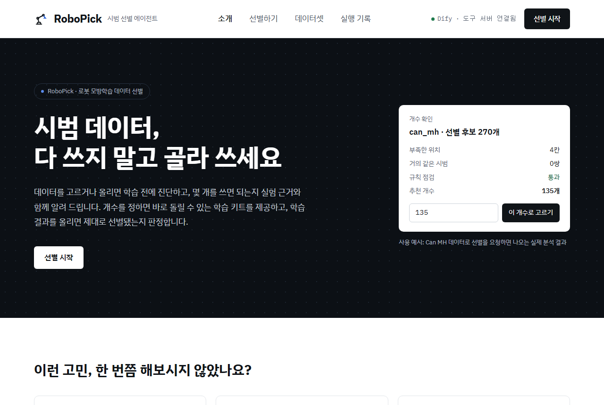
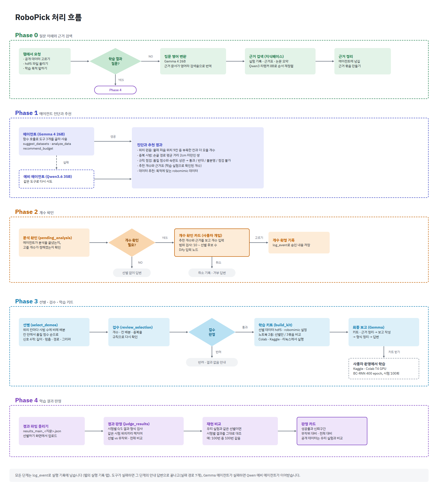
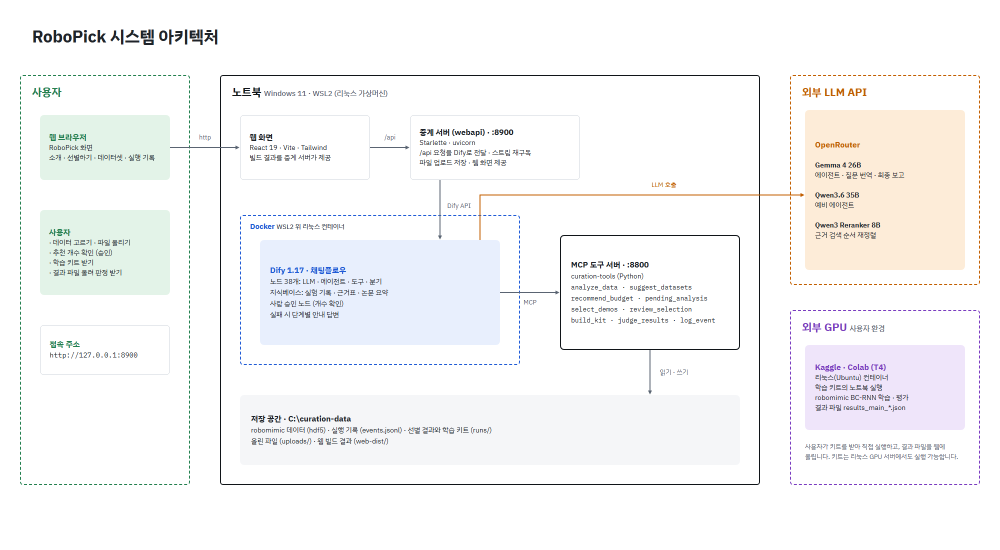
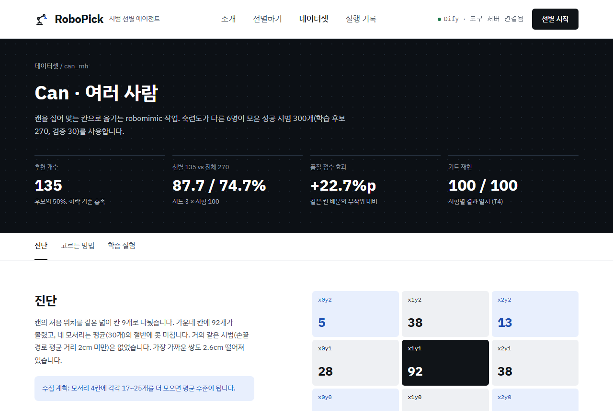
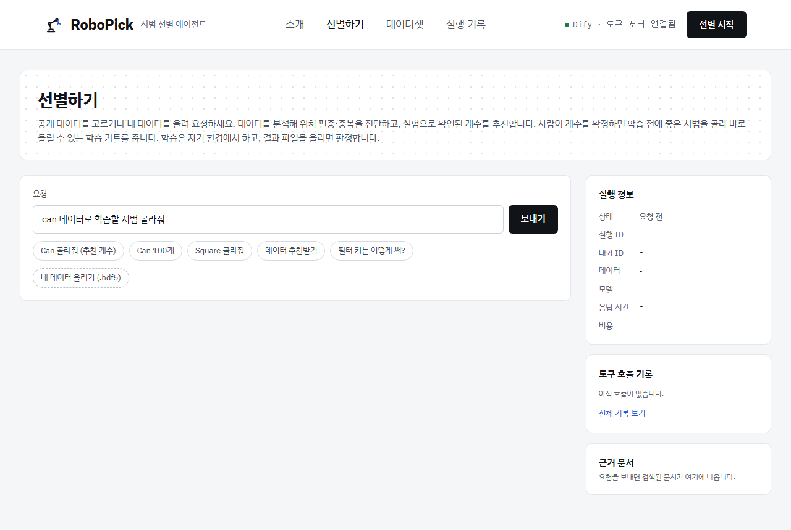

# RoboPick

로봇 모방학습용 시범(demonstration) 데이터를 학습 전에 진단하고, 좋은 시범만 골라 학습 키트로 만들어 주는 에이전트입니다. 고른 결과가 정말 나은지는 학습 결과 파일을 올리면 판정해 줍니다.

실전 AI 에이전트 시스템 설계·구축 개인 프로젝트 (8주차 MVP)



## 실험 결과 요약

robomimic Can (여러 사람이 모은 시범 300개, 학습 후보 270개) 기준입니다. 학습은 BC-RNN 400 epoch, 시험 100회이고, 같은 시험 위치끼리 짝지어 비교했습니다.

| 비교 | 결과 |
|---|---|
| 선별 135개 vs 전체 270개 | 87.7% vs 74.7%, 절반만 쓰고 더 높음 |
| 예산 60개에서 다른 고르는 방법 9가지와 비교 | 6가지는 시드 3개 모두 우리 방법이 높음, 3가지는 3개 중 2개 |
| 학습 키트 재현 (Kaggle T4) | 우리 실험과 시험 100번 중 100번 결과가 같음 |
| Square (더 어려운 작업, 600 epoch) | 선별 150개가 무작위보다 +10.7%p, 전체보다 +8.7%p |

자세한 수치는 [docs/12_budget60.md](docs/12_budget60.md), [docs/06_square.md](docs/06_square.md), [docs/16_kit_judge.md](docs/16_kit_judge.md)에 있습니다.

## 사용자 흐름

1. **데이터 정하기**: Can·Square 같은 공개 데이터를 고르거나 robomimic 형식(hdf5) 파일을 올립니다. 학습 목적만 말해도 맞는 데이터를 찾아 줍니다.
2. **진단 보기**: 물체 위치가 몰린 곳, 거의 같은 시범, 선별 규칙이 이 데이터에도 맞는지 확인합니다.
3. **개수 정하기**: 실험으로 확인된 추천 개수와 근거를 보고 사람이 직접 확정합니다.
4. **학습 키트 받기**: 선별한 데이터 파일, robomimic 설정, 노트북 2종(선별만 / 선별·무작위·전체 비교)을 받습니다.
5. **결과 올리기**: 자기 환경(Colab, Kaggle, 리눅스 서버)에서 학습한 결과 파일을 올리면 판정 카드를 줍니다.

## 처리 흐름

요청 하나가 Dify 채팅플로우(노드 38개)와 MCP 도구 서버를 거쳐 처리되는 순서입니다. 사람이 개입하는 곳은 Phase 2의 개수 확인 한 곳입니다.



## 아키텍처

발표 시연은 노트북 한 대에서 모두 실행합니다. 밖으로 나가는 것은 LLM 호출(OpenRouter)과 사용자가 직접 하는 학습뿐입니다.



| 구성 요소 | 역할 | 위치 |
|---|---|---|
| 웹 화면 (`web/`) | React 19 · Vite · Tailwind. 소개 · 선별하기 · 데이터셋 · 실행 기록 | 빌드 결과를 중계 서버가 제공 |
| 중계 서버 (`webapi/`) | `/api` 요청을 Dify API로 전달, 스트림이 끊기면 다시 구독, 파일 업로드 저장 | `127.0.0.1:8900` |
| Dify 채팅플로우 (`dify/curation_chatflow.yml`) | 질문 해석, 근거 검색, 에이전트, 사람 승인, 실패 처리 | Docker (WSL2 리눅스 컨테이너) |
| MCP 도구 서버 (`curation_tools/`) | 진단 · 선별 · 검수 · 키트 · 판정 · 기록 | `127.0.0.1:8800/mcp` |
| 저장 공간 | 데이터, 실행 기록, 선별 결과, 키트, 올린 파일 | `C:\curation-data` (저장소에 포함하지 않음) |

### LLM

모두 OpenRouter API로 씁니다.

| 모델 | 쓰는 곳 |
|---|---|
| Gemma 4 26B | 에이전트, 질문 영어 변환, 최종 보고 |
| Qwen3.6 35B | 예비 에이전트 (Gemma가 실패하면 이어받음) |
| Qwen3 Reranker 8B | 근거 검색 결과 순서 재정렬 |

## Dify 채팅플로우


- 노드 38개: LLM, 에이전트, 도구, 분기, 코드, 사람 입력 노드로 구성
- 에이전트는 함수 호출 방식으로 `suggest_datasets`, `analyze_data`, `recommend_budget`을 골라 씁니다.
- 개수 확인은 Dify의 사람 입력 노드로 멈춰서 기다립니다. 고르기 / 취소 두 갈래입니다.
- 도구가 실패하면 그 단계의 안내 답변으로 끝납니다 (실패 경로 7개). Dify는 MCP 도구 오류를 성공으로 처리하기 때문에, 검수 판정 노드에서 결과를 다시 확인합니다.

가져오는 방법과 노드별 설명은 [docs/17_dify_flow_v2.md](docs/17_dify_flow_v2.md)에 있습니다.

## MCP 도구

| 도구 | 하는 일 |
|---|---|
| `suggest_datasets` | 학습 목적을 듣고 맞는 robomimic 데이터 추천 |
| `analyze_data` | 위치 편중, 거의 같은 시범, 품질 신호, 규칙 점검 |
| `recommend_budget` | 실험으로 확인된 추천 개수와 근거표 |
| `pending_analysis` | 분석이 끝났는지, 개수가 정해졌는지 확인 |
| `select_demos` | 위치 칸마다 비례 배분하고 칸 안에서 품질 점수 순으로 선별 |
| `review_selection` | 개수 · 칸 배분 · 중복을 규칙으로 다시 검사 |
| `build_kit` | 선별 데이터, 학습 설정, 노트북을 묶은 학습 키트 |
| `judge_results` | 결과 파일 형식 검사, 무작위 · 전체와 비교, 우리 실험과 재현 비교 |
| `log_event` | 모든 단계를 실행 기록에 남김 |

`train_evaluate`(학습 계획 만들기와 등록된 학습 결과 비교표)도 들어 있지만, 지금 채팅플로우에서는 `build_kit`과 `judge_results`가 그 역할을 맡아 쓰지 않습니다.

## 선별 방법

라벨 없이 로봇이 움직인 기록만으로 품질을 매깁니다. 능숙한 사람일수록 짧게 끝내고, 덜 머뭇거리고, 덜 돌아가고, 그리퍼를 덜 여닫습니다. 이 네 신호를 합친 품질 점수로, 물체 처음 위치 9칸마다 시범 수에 비례해 개수를 나눈 뒤 칸 안에서 점수 순으로 고릅니다. 숙련도 라벨은 선별에 쓰지 않고 결과를 확인하는 데만 씁니다.



## 실행

필요한 것: Windows 11, Docker Desktop(Dify), conda 환경 `curation` (Python 3.10, h5py, numpy, `mcp[cli]<2`), Node.js(화면 빌드), OpenRouter API 키(Dify에 설정).

한 번에 켜기 (PowerShell, 이 폴더에서). Dify → MCP 도구 서버 → 화면 빌드 → 중계 서버 순서로 켜고 브라우저를 엽니다.

```powershell
powershell -ExecutionPolicy Bypass -File scripts\start.ps1
```

- 화면 코드를 고쳤으면 `-Build`를 붙입니다. 끄기는 `scripts\stop.ps1`
- 접속: http://127.0.0.1:8900
- Dify에는 `dify/curation_chatflow.yml`을 가져오고, MCP 도구 주소는 `http://host.docker.internal:8800/mcp`로 등록합니다.

테스트 (76개)

```powershell
conda run -n curation python -m pytest tests -q
```



## 폴더

| 폴더 | 내용 |
|---|---|
| `curation_tools/` | MCP 도구 서버 |
| `dify/` | Dify 채팅플로우 설정 |
| `webapi/` | 중계 서버 |
| `web/` | 웹 화면 |
| `kaggle/`, `colab/` | 학습 · 평가 노트북 |
| `analysis/`, `results/` | 실험 분석 스크립트와 결과 |
| `scripts/` | 켜기 · 끄기 스크립트 |
| `docs/` | 단계별 기록 (00~21) |
| `tests/` | 테스트 |
