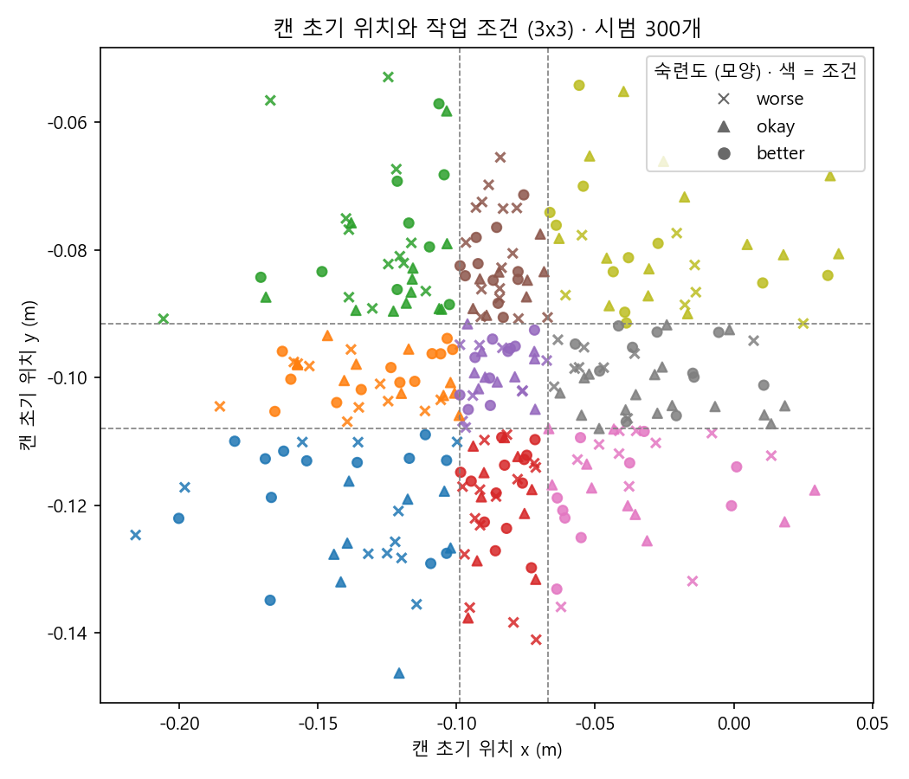

# 1단계: analyze_data 결과 (2026-10-11)

## 무엇을 만들었나
- `curation_tools/analyze.py`: robomimic hdf5를 읽어 시범별 특징과 작업 조건 분포를 계산
- 실행: `python -m curation_tools.analyze --dataset C:/curation-data/raw/can_mh_low_dim.hdf5`
- 출력 (`C:\curation-data\runs\<run_id>\`)
  - `analysis.json`: 시범별 특징 전체, 조건 정의, 조건별 통계, 품질 신호 검증표
  - `analysis_summary.json`: LLM에 넘기는 요약본. 시범별 목록과 숙련도 라벨을 뺐다 (원본 데이터를 외부 API로 보내지 않는다는 5주차 원칙)
  - `initial_positions.png`: 캔 초기 위치 산점도
- 테스트: `tests/test_analyze.py` 5개 통과

## 시범별 특징
| 구분 | 항목 | 계산 |
|---|---|---|
| 기본 | 길이 | `num_samples` |
| 작업 조건 | 캔 초기 위치 x, y | 첫 프레임 `obs/object[0:3]` |
| | 캔 초기 방향(yaw) | 첫 프레임 `obs/object[3:7]` 쿼터니언(x, y, z, w) |
| 품질 후보 신호 | 경로 길이 | `robot0_eef_pos` 프레임 간 이동 거리 합 |
| | 움직임 거칠기 | 팔 행동(action 앞 6차원)의 프레임 간 변화량 평균 |
| | 정지 비율 | 팔 끝 이동이 프레임당 1mm(=2cm/s) 미만인 비율 |
| | 그리퍼 개폐 횟수 | 그리퍼 행동(action 7번째) 부호가 바뀐 횟수 |
| 검증용 라벨 | 숙련도, 운영자, train/valid | 필터 키(`mask`) |

숙련도 라벨은 **선별에 쓰지 않고 검증에만** 쓴다. 실제 현장 데이터에는 이런 라벨이 없기 때문이다.

## 작업 조건 (3×3)
- 캔 초기 위치 (x, y)를 분위수 경계로 3×3 = 9칸으로 나눴다. x 경계 -0.2157 / -0.0989 / -0.0670 / 0.0378, y 경계 -0.1463 / -0.1080 / -0.0916 / -0.0529 (m)
- 방향(yaw)은 조건에서 뺐다. 캔은 원통이라 수직축 회전이 잡기에 거의 영향이 없고, 실제 데이터에서도 yaw 범위가 **±7도**에 불과했다
- 칸별 시범 수 29~37개, 모든 칸에 worse/okay/better가 섞여 있어 칸 안에서 품질로 고를 여지가 있다

| 조건 | 개수 | worse | okay | better | 평균 길이 |
|---|---|---|---|---|---|
| x0y0 | 32 | 11 | 8 | 13 | 188.9 |
| x0y1 | 34 | 11 | 11 | 12 | 194.4 |
| x0y2 | 34 | 13 | 12 | 9 | 206.9 |
| x1y0 | 37 | 14 | 10 | 13 | 216.1 |
| x1y1 | 29 | 9 | 10 | 10 | 240.3 |
| x1y2 | 34 | 15 | 8 | 11 | 242.1 |
| x2y0 | 31 | 11 | 10 | 10 | 215.5 |
| x2y1 | 37 | 9 | 17 | 11 | 199.5 |
| x2y2 | 32 | 7 | 14 | 11 | 181.4 |

## 품질 신호 검증 (숙련도와의 관계)
| 신호 | worse | okay | better | 스피어만 상관 | 판단 |
|---|---|---|---|---|---|
| 길이(프레임) | 304.4 | 180.5 | 142.6 | -0.72 | 매우 강함 |
| 정지 비율 | 0.095 | 0.058 | 0.037 | -0.44 | 사용 |
| 경로 길이(m) | 1.568 | 1.226 | 1.123 | -0.42 | 사용 |
| 그리퍼 개폐 횟수 | 2.96 | 2.06 | 2.02 | -0.30 | 약하게 사용 |
| 움직임 거칠기 | 0.171 | 0.189 | 0.160 | -0.08 | **제외** (숙련도와 관계 없음) |

서툰 운영자의 시범은 두 배 이상 길고, 더 많이 머뭇거리고, 더 돌아가고, 다시 집는 일이 잦다.

## 2단계에 주는 시사점
- 가장 강한 신호가 "길이가 짧을수록 좋다"이므로, 이 신호로 고르면 **총 프레임 수가 자동으로 줄어든다.** 그러면 성능 차이가 선별 때문인지 학습량 차이 때문인지 구분하기 어렵다
- 그래서 2단계에서는 시범 개수 예산과 **프레임 예산을 함께 보고**하고, 비교 실험에 **프레임 수를 맞춘 무작위 기준선**을 추가한다 (1주차 문제정의서의 "총 프레임 예산을 맞춘 실험"과 같은 맥락)
- 품질 점수에는 길이·정지 비율·경로 길이·그리퍼 개폐를 쓰고, 움직임 거칠기는 뺀다. 각 신호의 방향(작을수록 좋음)은 위 검증표로 정했다

## 한계
- 품질 신호는 숙련도 라벨과의 상관으로만 확인했다. 실제로 학습 성능에 도움이 되는지는 3단계 이후 코랩 실험으로 확인한다
- 정지 판정 기준(1mm/프레임)은 임의로 정한 값이다
