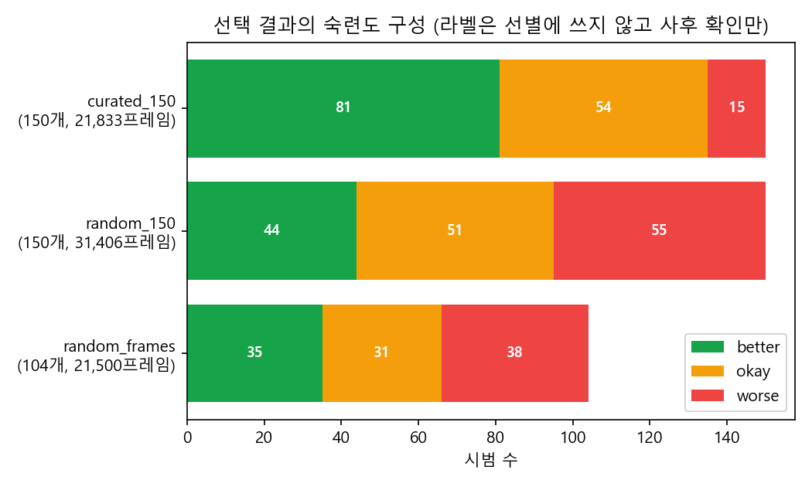

# 2단계: select_demos 결과 (2026-10-11)

## 무엇을 만들었나
- `curation_tools/select_demos.py`: analyze_data 결과를 읽어 예산만큼 시범을 고르고, 비교용 무작위 기준선을 함께 만든다
- 실행: `python -m curation_tools.select_demos --analysis C:/curation-data/runs/R-20261011-analyze01/analysis.json`
- 출력 (`C:\curation-data\runs\R-20261011-select01\`)
  - `selection.json`: 5주차 분석가 출력 형식(budget, allocation, selected_ids, total_frames, settings, timing_sec) + 기준선, 검사 결과, 사후 확인
  - `selection_summary.json`: LLM에 넘기는 요약본. ID 목록, 점수, 숙련도 라벨을 뺐다
  - `can_mh_curated.hdf5`: 원본 복사본에 필터 키 `curated_150`, `random_150`, `random_frames`를 넣은 파일. 원본은 건드리지 않는다. robomimic 학습 설정의 `train.hdf5_filter_key`만 바꾸면 각 묶음으로 학습할 수 있다
- 테스트: `tests/test_select.py` 6개 통과 (전체 11개)
- 모듈 이름은 파이썬 기본 모듈 `select`와 겹치지 않게 `select_demos`로 했다

## 방법
1. **후보**: train 270개 (worse/okay/better 90개씩, 56,186프레임). valid 30개는 학습 중 검증용이라 선별에 쓰지 않는다 (5주차 "평가용 데이터는 선별에 쓰지 않는다")
2. **품질 점수**: 길이, 정지 비율, 경로 길이, 그리퍼 개폐 횟수를 후보 안 순위 백분위(0~1)로 바꿔 평균. 낮을수록 좋다. 가중치는 동일하게 뒀다. 1단계 상관값으로 가중치를 주면 숙련도 라벨 정보가 선별에 새어 들어가기 때문이다
3. **배분**: 예산 150개를 칸 크기 비율로 나누고, 내림 후 남는 개수는 소수점 아래가 큰 칸부터 1개씩 준다
4. **선택**: 칸 안에서 품질 점수 순으로 배분된 개수만큼 고른다
5. **기준선**: seed 0으로 같은 개수 무작위(`random_150`), 총 프레임을 ±2% 안으로 맞춘 무작위(`random_frames`)

## 결과

| 조건 | 후보 | 배분 = 선택 | 부족 |
|---|---|---|---|
| x0y0 | 30 | 17 | 0 |
| x0y1 | 31 | 17 | 0 |
| x0y2 | 31 | 17 | 0 |
| x1y0 | 33 | 19 | 0 |
| x1y1 | 25 | 14 | 0 |
| x1y2 | 31 | 17 | 0 |
| x2y0 | 27 | 15 | 0 |
| x2y1 | 33 | 18 | 0 |
| x2y2 | 29 | 16 | 0 |

| 묶음 | 시범 수 | 총 프레임 | worse | okay | better |
|---|---|---|---|---|---|
| curated_150 | 150 | 21,833 | 15 | 54 | 81 |
| random_150 | 150 | 31,406 | 55 | 51 | 44 |
| random_frames | 104 | 21,500 (-1.5%) | 38 | 31 | 35 |
| train (전체, 비교 상한) | 270 | 56,186 | 90 | 90 | 90 |

- 라벨 없이 고른 150개에 train의 better 90개 중 81개가 들어갔고, worse는 15개만 남았다
- 짧은 시범을 고르는 방식이라 같은 150개라도 총 프레임이 무작위보다 30% 적다. 그래서 학습량을 맞춘 `random_frames`가 필요하다
- 고르는 데 0.004초, 복사본 만드는 데 0.1초

## 검증
- 규칙 검사 (5주차 검수자 항목): 예산 초과, 중복, valid 포함, 칸별 합계, 프레임 맞춤 → 모두 통과 (verdict pass)
- 라벨을 지운 데이터로 돌려도 같은 150개가 나온다 → 선별에 라벨을 쓰지 않았다는 증거
- 같은 seed로 다시 돌리면 세 묶음 모두 같다 (재현성)
- **칸 안 위치 쏠림**: 칸마다 고른 시범과 안 고른 시범의 평균 위치 차이를 칸 안 위치 퍼짐으로 나눈 비율. curated는 평균 0.25, 최대 0.54(x2y0, 1.5cm). 무작위로 150개를 100번 뽑았을 때 평균 0.33, 95% 기준 0.72 → 우연 수준이라 칸 안 다양성 기능은 넣지 않았다. 이 기준을 넘으면 도구가 `position_shift` 문제로 보고한다

## 5단계(학습·평가)에서 비교할 묶음
`curated_150`, `random_150`, `random_frames`, `train` 전체. 숙련도 라벨을 쓴 참고용 상한으로 robomimic 공식 필터 키 `better_train`(90개), `okay_better_train`(180개)도 함께 볼 수 있다.

## 한계
- "작을수록 좋다"는 신호 방향은 상식으로도 나오지만, 1단계에서 라벨로 확인한 뒤 정했다
- 라벨 기준으로 잘 골랐다는 것이지, 학습 성능이 오른다는 증거는 아니다. 5단계 코랩 실험으로 확인한다
- 예산 150, 가중치 동일, 허용 오차 ±2%는 정해서 쓴 값이다
