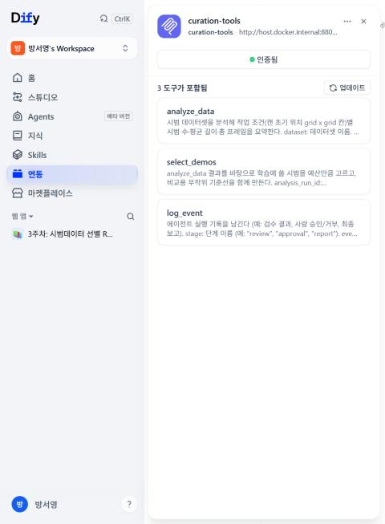
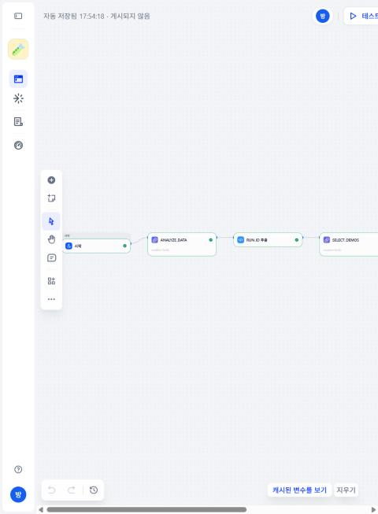
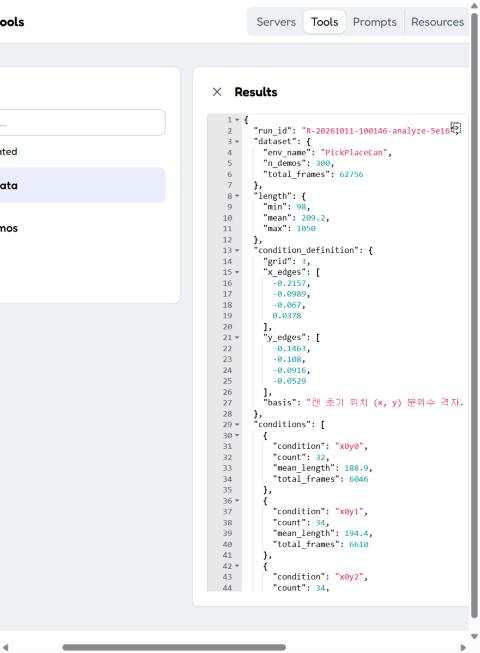

# 3단계: MCP 도구 서버 curation-tools (2026-10-11)

## 무엇을 만들었나
- `curation_tools/server.py`: 1~2단계 함수를 MCP 도구로 묶은 서버 (MCP 파이썬 SDK 1.30, FastMCP)
- 주소 `http://127.0.0.1:8800/mcp`. Dify 컨테이너에서는 `http://host.docker.internal:8800/mcp`
- 도구 3개

| 도구 | 입력 | 돌려주는 것 |
|---|---|---|
| analyze_data | dataset(이름, 현재 `can_mh`), grid(2~5), session_id | run_id, 조건별 시범 수·평균 길이·총 프레임 |
| select_demos | analysis_run_id, budget(10~270), seed, session_id | run_id, 조건별 배분, 묶음별 시범 수·프레임, 검사 결과, 필터 키 이름 |
| log_event | stage, event, detail, run_id, session_id | `{"ok": true}` |

- train_evaluate는 5단계(코랩 학습)에서 만들어 이 서버에 추가한다
- 작업 브랜치: `feat/mcp-server` → PR로 main에 합친다 (3단계부터 브랜치 사용)

## 설계에서 신경 쓴 점
- **경로를 받지 않는다**: 도구 인자는 LLM이 정한다. 데이터는 이름으로만 고르고(서버가 실제 경로로 바꿈), run_id는 형식(`R-...`)을 검사한 뒤 `C:\curation-data\runs` 바로 아래 폴더만 읽는다. `../raw`, 절대 경로, 없는 run_id, 범위 밖 예산은 거절한다 (테스트로 확인)
- **LLM에는 요약만**: 시범 ID 목록과 숙련도 라벨은 응답에 넣지 않는다 (5주차 데이터 민감도 원칙). 숙련도 구성은 프론트가 결과 파일에서 직접 읽어 보여줄 예정
- **자동 기록**: 모든 도구 호출이 `C:\curation-data\logs\events.jsonl`에 남는다 (시작, 끝, 걸린 시간, 인자, run_id, 오류). Dify가 log_event를 부르지 않아도 이력이 남는다. session_id로 같은 대화의 호출을 묶는다
  - 계획에서는 실행 폴더마다 기록 파일을 두려 했으나, 분석과 선별의 run_id가 달라 한 대화의 흐름을 보기 어려워서 파일 하나로 모았다
- **보안 설정**: DNS 리바인딩 방어는 켜 두고 `host.docker.internal`만 허용 목록에 추가 (0단계에서 확인한 설정)

## 확인 결과
| 방법 | 결과 |
|---|---|
| pytest (메모리 안 MCP 클라이언트) | 서버 테스트 8개 포함 전체 19개 통과 |
| 파이썬 HTTP 클라이언트 → 8800 | analyze → select 성공, 결과가 2단계와 같음 (21,833 / 31,406 / 21,500 프레임) |
| MCP Inspector 2.8.0 | 연결, 도구 3개 표시, analyze_data 실행 성공 |
| Dify 1.17 | MCP 서버 등록(도구 3개 인식), 시험 워크플로우 `test-curation-tools`에서 analyze_data → run_id 추출(코드 노드) → select_demos → log_event 모두 성공 (전체 1.8초) |

## 알게 된 것 (4단계에 쓸 것)
- **Dify에서 MCP 도구 결과는 `text`가 아니라 `json` 칸으로 들어온다** (서버가 구조화된 결과를 돌려주기 때문). 처음에 코드 노드가 `text`를 읽다가 빈 값이라 실패했다. 다음 노드에서 쓸 때는 `{{#노드.json#}}`의 첫 원소를 쓴다
- Dify의 MCP 서버 삭제 API는 서버 식별자가 아니라 내부 ID를 받는다 (화면에서 지우면 된다)
- Inspector 최신판(2.10.1)은 나온 지 사흘이라 2주 지난 2.8.0을 썼다

## 정리한 것
- Dify 시험 앱 `test-mcp-hitl`, 시험 MCP 도구 `test-hello` 삭제 (0단계에서 만든 것)
- `test-curation-tools`는 4단계까지 참고용으로 두고 이후 삭제

## 관련 파일
- 코드 `curation_tools/server.py`, 테스트 `tests/test_server.py`
- 실행 방법 `README.md`
- PR 양식 `.github/pull_request_template.md`
