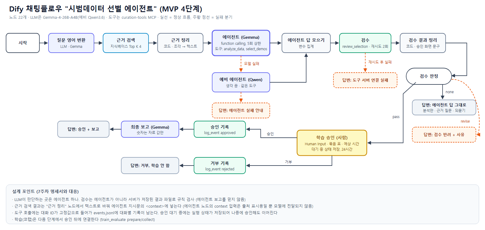

# 4단계: Dify 채팅플로우 통합 (2026-10-11)

## 무엇을 만들었나
- Dify 채팅플로우 **"시범데이터 선별 에이전트"** (노드 22개). 설정 파일 `dify/curation_chatflow.yml`
- 도구 서버에 검수 도구 **review_selection** 추가 (`curation_tools/review.py`, `server.py`)
- 설계 근거: 7주차 설계 명세서(`../7주차/제출물/`), 모델 선택: 6주차 벤치(`../6주차/모델선택/`)
- 작업 브랜치 `feat/dify-chatflow`

## 흐름
1. 질문 영어 변환 (Gemma) → 근거 검색 (demo-curation-kb, Top K 4) → 근거 정리 (코드: 문서 조각 → 텍스트)
2. **에이전트 (Gemma-4-26B-A4B, function calling, 반복 상한 5회)**: 요청을 해석해 analyze_data → select_demos를 스스로 호출하거나, 근거 질문이면 도구 없이 문서로 답하거나, 예산이 범위 밖이면 되묻는다. 대화 기억 10턴
3. 예비 에이전트 (Qwen3.6, 생각 끔): 주 모델 호출이 실패하면 대신 실행 → 답 모으기(변수 집계)
4. **검수 (review_selection)**: 이 대화에서 아직 검수하지 않은 최신 선별 결과를 서버가 저장된 파일로 다시 검사. 재시도 2회
5. 검수 판정: pass → 사람 승인 / revise → 사유 안내 / none(선별 없음) → 에이전트 답 그대로
6. **학습 승인 (Human Input)**: 묶음 4개 표, 검수 결과, 예상 시간(약 120분), "되돌릴 수 없음"을 보여주고 승인/거부. 대기 중 상태 저장(24시간)
7. 승인 → log_event(approved) → 최종 보고 (Gemma) / 거부 → log_event(rejected) → 안내

모든 도구 호출에는 대화 ID가 고정값으로 들어가서 `C:\curation-data\logs\events.jsonl`에 대화별로 남는다.

## review_selection (검수 도구)
- 입력: session_id(대화 ID) 또는 run_id
- 저장된 `selection.json`과 `analysis.json`만 읽어 규칙 검사: 예산, 중복, 분석에 없는 ID, valid 포함(평가 누수), 칸별 합계, 기록된 총 프레임과 실제 합, 프레임 맞춘 기준선, 필터 키 복사본. 부족한 칸은 경고
- 에이전트가 말한 숫자는 보지 않는다 (5주차 "자기가 고른 결과를 자기가 검토하지 않는다")
- 같은 결과를 두 번 검수하지 않는다 (이미 검수한 run_id는 건너뜀 → 이번 턴에 선별이 없으면 verdict none)
- 응답에 시범 ID와 숙련도 라벨 없음. 학습 계획(묶음 4개, 묶음당 약 30분 추정) 포함
- 테스트: 정상 pass, 재검수 none, 파일을 조작해 예산을 넘기면 revise(budget, duplicate, allocation) — 전체 20개 통과

## 시나리오 테스트 (Dify 콘솔 API로 실행, 승인은 폼 API로 제출)

| 번호 | 입력 | 기대 | 결과 |
|---|---|---|---|
| S1 | can 데이터로 학습할 시범 150개 골라줘 → 승인 | 분석 → 선별 → 검수 pass → 승인 → 보고 | 통과. 승인 화면까지 9.8~11.4초, 보고 수치가 도구 결과와 일치 |
| S2 | 시범 좀 골라줘 → 거부 | 기본값 150 명시 → 승인 화면 → 거부 기록 | 통과 |
| S3 | 예산 500개로 시범 골라줘 | 도구 호출 없이 범위 안내 | 통과 (5.2초) |
| S7 | (S3에 이어서) 그럼 100개로 해줘 | 대화 기억으로 budget=100 선별 | 통과 (서버 기록에서 budget 100 확인) |
| S5 | 작업 조건별로 분포만 보여줘 | analyze_data만 | 통과 |
| S4 | 일부 시범만 골라서 학습하려면 어떻게 설정해? | 문서 근거 + 출처 | **부분 통과**: 출처 있는 답이지만 핵심(필터 키, hdf5_filter_key) 누락. 3주차부터 실패하던 Q3로, 검색 단계에서 해당 조각을 못 가져오는 한계 |
| S4b | 우리 Can 실험에서 DemInf 성공률이 몇 %였어? | "확인 필요" | 통과 |
| S4c | MH 데이터셋 운영자 수와 숙련도 | 6명, 2명씩 + 출처 | 통과 |
| S6 | 도구 서버를 끈 상태에서 150개 요청 | 실패 사실 안내, 지어낸 결과 없음 | 통과 (에이전트가 오류 전달, 검수 재시도 후 실패 분기) |
| S8 | 주 모델 이름을 일부러 틀리게 설정 | 예비 모델(Qwen)로 진행 | 통과 (확인 후 Gemma로 복구) |

검수 반려(revise) 경로는 Dify에서 자연스럽게 만들 수 없어 서버 테스트(파일 조작)로만 확인했다.

## 테스트하며 고친 것
- **에이전트 노드의 context 입력은 모델에 전달되지 않는다.** 플러그인 코드를 보니 출처 표시용으로만 쓰인다. 그래서 "근거 정리" 코드 노드를 추가해 검색 결과를 지시문의 `<context>` 자리에 직접 넣었다. 수정 전에는 근거 질문에 문서와 상관없는 답을 했다
- **예비 모델로 넘어가면 답변이 비었다.** 답변 노드가 주 에이전트 출력만 참조했기 때문. "에이전트 답 모으기"(변수 집계) 노드로 두 에이전트 중 실행된 쪽 출력을 쓰게 했다
- 에이전트와 보고가 학습 전인데 "최적의 시범"이라고 표현 → 두 곳 모두 "결과 평가 표현 금지" 규칙 추가
- MCP 도구 결과는 `json` 칸으로 들어온다 (3단계에서 확인) → 검수 결과는 코드 노드에서 `json[0]`으로 읽음

## 정리
- Dify 시험 앱 `test-curation-tools` 삭제 (3단계에서 만든 것)
- 6주차 벤치 앱 bench-agent / bench-rag / bench-report는 gpt-oss-20b 실행이 남아 있어 유지

## 다음 단계로 넘기는 것
- 승인 뒤 train_evaluate(prepare/collect)와 코랩 학습 연결 (5단계)
- 데모 프론트: Human Input은 콘솔/웹앱 폼 API로 제출 가능함을 확인 (`POST /form/human_input/<form_token>`, 이번 테스트에서 사용)
- S4(필터 키 질문)는 RAG 검색 한계 — 문서 청킹 조정이나 다중 검색어가 후보

## 다시 만드는 방법
1. 도구 서버 켜기 (`README.md` 실행 절)
2. Dify → 스튜디오 → DSL 파일 가져오기 → `dify/curation_chatflow.yml`
3. 지식베이스(demo-curation-kb)와 MCP 도구(curation-tools)가 같은 이름으로 있어야 한다. 다른 워크스페이스에서는 근거 검색 노드의 지식베이스를 다시 선택해야 한다
